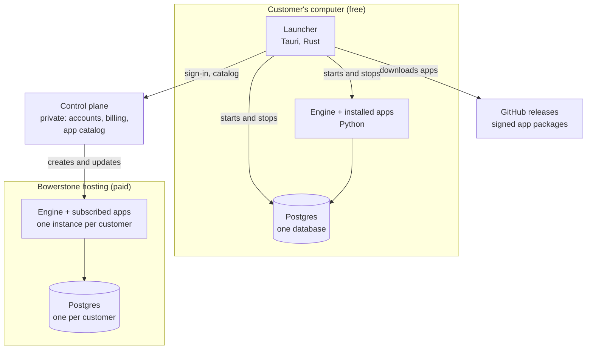

# Bowerstone: Platform Architecture

Oct 12, 2026 · Prepared by Ilia Fatemi · Status: decided on the technical side, for discussion with the partner

Bowerstone is no longer one program. It is a family of programs (accounting, invoicing, CRM, and more) that a customer installs and removes from a desktop launcher, or uses together on the paid web version. This note sets the architecture that every program follows. It sits above the v1 ledger architecture note, which describes the ledger inside the first program, Accounting.

## Decisions in this note

| # | Decision | Status |
| --- | --- | --- |
| P1 | Each product is a separate program (an "app") with its own code, data, version, and releases | Decided |
| P2 | All apps run on one shared engine. There is one backend program, not one per app | Decided |
| P3 | Apps are connected. They share one customer list and one set of books when installed together | Decided (Oct 12) |
| P4 | Each installation has one Postgres database, with a separate schema for each app | Decided |
| P5 | The screens stay in React and TypeScript. Rust is used for the desktop launcher | Decided |
| P6 | One shared design system makes every app look the same everywhere | Decided |
| P7 | A desktop launcher installs, opens, updates, and removes apps | Decided. Built in the desktop phase |
| P8 | Moving to the paid web version is a one-time move by backup file | Decided (Oct 12) |
| P9 | The paid web version keeps one instance and one database per customer | Decided (Oct 12) |
| P10 | Each app has its own code repository. The engine, the design system, and the shell live in `bowerstone-platform` | Decided (Oct 12) |
| P11 | Accounts, billing, and the app catalog live in a separate private service | Decided |
| P12 | Each app carries its own built screens, and the shell loads them when it opens | Decided (Oct 12) |
| P13 | The first app is Accounting (key `accounting`). The ledger is its core | Decided (Oct 12) |

## The parts



| Part | What it is | Open source |
| --- | --- | --- |
| Engine | The one backend program. It provides sign-in, users and permissions, the shared customer list, the change history, events, backups, and the loader that runs apps | Yes |
| Apps | Accounting, invoicing, CRM, and later programs. Each app has its own repository and package, holding its backend code, database schema, screens, and version | Yes |
| Shell and design system | The screens. One React app (the shell) shows the screens of every installed app, and all of them use one shared component library | Yes |
| Launcher | The desktop program. It installs and removes apps, runs Postgres and the engine, opens the window, and handles updates | Yes |
| Control plane | Bowerstone's own service for accounts, billing through Stripe, subscriptions, the app catalog, and creating hosted instances | No, private |

## One backend or many?

**One backend program, with each app loaded into it as a separate module.** This pattern is called a modular monolith, and it is how the closest products work: Odoo and Frappe/ERPNext both run many business apps on one engine and one database.

The alternative is a separate backend and database per app. That keeps the apps further apart, but it fails on the decision that matters most, P3:

- **Saving an invoice must also save its accounting entry.** With one backend and one database, both happen in one transaction: both are saved, or neither is. With separate backends, two programs must agree over the network, and a failure halfway leaves an invoice with no entry in the books.
- **The customer list is shared.** One copy lives in the engine. Separate backends would each keep a copy and need to sync them.
- **The desktop stays light.** One engine and one Postgres use far less memory than one of each per app.
- **Shared basics are built once.** Sign-in, permissions, backups, export, and the change history exist once, not once per app.

The apps are separate where they are written and released (P10). They are joined only where they run: inside one engine, on one database.

### How the apps stay separate

| Boundary | Rule |
| --- | --- |
| Code | Each app is its own repository and Python package. An app may import only the engine's public interface and the public module of the apps it declares it needs. A check in every app's automated build fails on any other import |
| Data | Each app owns its own Postgres schema (`accounting`, `invoicing`, `crm`). Only that app writes its tables. Other apps use its public functions |
| Shared data | Data more than one app needs, such as the company, users, and the customer list, lives in the engine's `core` schema |
| Dependencies | Each app has a manifest that lists the apps it needs. Invoicing needs Accounting. The engine installs an app's dependencies with it, and refuses if one is missing. It refuses to remove an app that another app needs |
| Reacting to each other | Apps announce changes as events in the same transaction. Another app can react without the first one knowing it exists |
| Versions | The engine and each app have their own version numbers and releases. An app states which engine versions, and which versions of the apps it needs, it works with |
| Public functions | An app's public functions are a promise. Changing one in a way that breaks callers needs a new major version, and contract tests check every release |

### Apps and plugins

The earlier notes describe plugins. An app is the same mechanism made bigger: a package with a manifest, its own schema, routes, screens, and events, loaded by the engine. The difference is ownership. Apps are Bowerstone's own products and are fully open source. Plugins are smaller add-ons that may be paid and under their own terms. Both use the same loader, so building apps first proves the plugin system before anyone else writes a plugin.

## How an app is found and installed

Every app package carries a manifest under the entry point group `bowerstone.apps`. It names the app, its version, the apps and engine versions it needs, its migrations, its routes, and its permissions. When the engine starts, it looks for every installed package with that entry point, and loads the ones switched on in this database.

| Where | Steps |
| --- | --- |
| Desktop | The customer ticks the app in the launcher. The launcher downloads the signed package from the app's GitHub release, adds it to the engine's bundled Python, runs `bowerstone apps install <key>`, and restarts the engine |
| Docker and hosted | The image holds the engine and the chosen app packages. `bowerstone apps install <key>` runs once, and the engine loads the app at every start |
| A developer | `pip install bowerstone-crm` also installs the engine, because the app lists it as a dependency. Then `bowerstone apps install crm` and `bowerstone serve` |

An app cannot run without the engine, in the same way a phone app needs a phone.

## Saving data on the desktop

**One local Postgres per computer, run by the launcher, with one database for all installed apps.**

- **Inside the database:** the `core` schema holds the company, users, permissions, the customer list, the change history, and events. Each app adds its own schema when it is installed.
- **Where it lives:** the database files live in the user's app-data folder, never in the program folder, so updates and reinstalls cannot touch them. This was already set out in the v1 ledger architecture note.
- **Backups:** a backup covers the whole database, so the books and the invoices that created them are always saved together.

| Action in the launcher | What happens to the data |
| --- | --- |
| Install an app | The engine creates the app's schema and runs its migrations |
| Update an app | The app's new migrations run. Once backups are built, a backup is taken first |
| Remove an app | Its screens and routes disappear. Its data is kept by default, so reinstalling restores everything |
| Remove an app and delete its data | Allowed only for apps whose data may be deleted. Accounting data is never deleted, because business records must generally be kept for six years under CRA rules |
| Remove an app another app needs | Refused, with a message naming the app that needs it |

## The paid web version

**The same engine and apps, run by Bowerstone, with one instance and one database per customer (P9).**

- **What the customer gets.** A hosted customer gets exactly what the desktop runs, with the apps they subscribe to installed. A fix or feature reaches both at once.
- **Isolation.** One customer's data never shares a table with another's.
- **Cost.** Each instance has a fixed running cost, which sets a floor for the price. The hosting automation listed in the v1 ledger architecture note is required.

The control plane is a separate, private service (P11). It holds:

- Bowerstone accounts and sign-in to the website
- billing through Stripe, and subscriptions
- which apps each hosted customer pays for
- the app catalog the launcher reads
- the tools that create, update, and back up hosted instances

The control plane never holds a customer's books. A hosted instance asks the control plane only which apps it may run, and the books stay inside the instance.

### What customers pay for

Every app is open source, so anyone can run all of them free on their own computer. The paid product is the hosting itself:

- access from anywhere
- automatic backups and updates
- no setup
- support

The pricing must make sense on that basis, because app access by itself cannot be sold.

## Moving between desktop and web (P8)

A one-time move uses a Bowerstone backup file.

1. **Export.** On the desktop, the customer exports a backup file. It holds the whole database, a list of the installed apps and their versions, and a checksum.
2. **Import.** In the web version, the import checks the checksum and the versions, then restores the file into the customer's instance.
3. **Switch.** The web copy becomes the live one. The desktop copy is marked "moved" and opens read-only, so two copies are never edited at the same time.
4. **Move back.** Moving back to the desktop works the same way in reverse.

Ongoing two-way sync is not planned. Two copies cannot both hand out the next entry number, and offline edits to the same record would conflict.

## Screens: React or Rust?

**React and TypeScript for every screen (P5). Rust for the desktop launcher only.**

| | React and TypeScript | Rust UI (Dioxus, Leptos, Yew) |
| --- | --- | --- |
| Maturity | Stable for years, with very large use | Still before version 1.0, and APIs change between releases |
| Components and accessibility | Mature libraries and guidance | Fewer components, and more must be built by hand |
| The design guides in the rules | Written for React and the web | Do not apply |
| Hiring and contributors | Very large pool | Small pool |
| Runs in browser and desktop | Yes. The desktop window shows the same web screens | Yes, but with less mature tooling |

Rust still has a place. The launcher is built with Tauri, which is Rust. It handles what Rust is good at: managing processes, files, Postgres, signatures, and updates.

### Looking the same everywhere (P6, P12)

Every run mode shows the same React shell:

- **Web version:** the engine serves the shell to the browser.
- **Docker:** the same engine serves the same shell to the browser.
- **Desktop:** the launcher opens a window that shows the same shell.

How the screens of each app reach the shell:

- **Each app carries its own screens.** Its package holds its screens, built ahead of time into one file.
- **The shell loads them when it opens.** It asks the engine which apps are installed, then loads the screens of each one from the engine. Nothing is loaded from outside the installation.
- **Shared pieces come from the shell.** React and the design system (`@bowerstone/ui`) are provided by the shell, so every app uses the same copy and looks the same.
- **Versions are checked.** An app states the range of design system versions its screens work with, and the shell refuses screens outside that range, with a clear message.

A new app therefore needs no new shell. The plugin system will use the same mechanism later.

The only difference between run modes is the browser engine underneath: Chrome or Firefox on the web, and each operating system's own web view on the desktop. The screen tests therefore run on all three systems in the desktop phase.

## The launcher (P7)

The launcher is the desktop program a customer downloads.

- **The home screen** lists the available apps, with buttons to install, open, update, and remove each one.
- **Running things.** It runs one Postgres with `postgresql_embedded` and one engine. The engine uses a bundled Python runtime (python-build-standalone), so that installing an app means adding its package without rebuilding the launcher.
- **Downloads.** It downloads app packages from GitHub releases and refuses any package without Bowerstone's signature.
- **A single-product download.** It is the launcher with that app ticked, not a separate kind of program.
- **The contract.** The launcher works through the engine's commands: `bowerstone apps install`, `bowerstone apps uninstall`, `bowerstone apps list`, and `bowerstone migrate`. Those commands are built first, so the launcher can be added later without changing the engine.

The launcher is built in the desktop phase, as decided earlier. Until then, Docker covers desktop use.

## Repositories (P10)

| Repository | Holds | Publishes |
| --- | --- | --- |
| `bowerstone-platform` | The engine, the design system, the shell, the Docker image, and copies of the decision notes | `bowerstone-engine` on PyPI. `@bowerstone/ui` and `@bowerstone/shell` on npm. The Docker image |
| `bowerstone-app-template` | The starting point for every new app repository: layout, rules, automated builds, and tests | Nothing. New app repositories are created from it |
| `bowerstone-accounting` | The first app | `bowerstone-accounting` on PyPI, with its screens inside, plus a signed GitHub release |
| `bowerstone-invoicing`, `bowerstone-crm`, … | Later apps, one repository each | The same as Accounting |
| `bowerstone-launcher` | The desktop launcher, in the desktop phase | Signed installers |
| `bowerstone-cloud` | Private: accounts, billing, and hosting tools | Nothing public |

Each repository is created when its work begins. Every one has its own CLAUDE.md, `features.md`, automated builds, and branch protection.

An app repository looks like this:

```text
bowerstone-accounting/
├── src/bowerstone_accounting/   # backend: manifest, public module, routes, migrations
├── web/                         # the screens, built into the package
├── tests/
├── compose.dev.yaml             # a development Postgres
├── pyproject.toml               # needs bowerstone-engine, within a version range
├── package.json                 # needs @bowerstone/ui and @bowerstone/shell, within a version range
└── CLAUDE.md, features.md, README.md, LICENSE
```

### Working across repositories

- **Versions.** Apps depend on published versions of the engine, the design system, and other apps. Until version 1.0, a new minor version may break things, so apps accept one minor version at a time.
- **Contract tests.** An app tests its public functions as a promise. An app that depends on another app runs its tests against the oldest and newest versions in its range.
- **Changing the engine and an app together.** On a developer's computer, the app can point at a local copy of the platform for testing. That setting is never committed. The engine change is released first, then the app updates its version range.
- **The import check.** The engine ships a command that checks an app's imports against the boundary rules. Every app's automated build runs it.

## What this changes in earlier notes

| Earlier note | Change |
| --- | --- |
| System Architecture and Tech Stack (v1 Ledger) | It now describes the ledger inside the Accounting app. Its six tables split between the engine's `core` schema and the `accounting` schema. The `core` schema also gains the shared customer list and events |
| Plugins in the Technical and Product Plan | Apps and plugins share one loader. Apps come first |
| v1 Charter, decision 6 (build our own ledger) | The case for building is stronger now, because the platform carries several products |
| Initial Setup Plan | The repository layout is replaced by the repositories above. The schema safeguards stay, split between `core` and `accounting` |
| Charter, run modes | Unchanged. Hosted and Docker come first, the launcher in the desktop phase |

## Risks

| Risk | Why it matters | How to reduce it |
| --- | --- | --- |
| An app reaches into another app's tables | The separation exists only in code | The import check in every app's build. Each app writes only its own schema |
| A faulty app stops the engine for every app | All apps run in one process | Only Bowerstone writes apps, and every change is reviewed and tested. The database still guards the books |
| App versions drift apart | An app may need a newer engine than a customer has | Each manifest states the engine versions it works with. The engine refuses an app that does not match |
| A change to an app's public functions breaks the apps that use it | Invoicing calls Accounting | Contract tests on every release, and a new major version for any breaking change |
| Work across repositories slows early development | The engine changes often at first, and each change touches the engine and an app | Build the engine's public interface early and keep it small. Release the platform often in the first months |
| A hosted price below cost | Every customer has a fixed instance cost | Price from the running cost per instance. Automate instance set-up early |
| Many apps make the project too big for one developer | Each app adds code to maintain | Build one app fully before starting the next. Accounting, then invoicing, then CRM |

## The build plan

The Platform Build Plan turns this note into tasks for Claude Code, in phases 0 to 6:

0. The repositories
1. The engine
2. The screens
3. Publishing and the app template
4. The Accounting app
5. The Invoicing app
6. The Docker image and end-to-end tests

Each task has its own design details and a "done when" check. The launcher follows later, in the desktop phase.

# Next Section
[[Bowerstone System Architecture and Tech Stack (v1 Ledger)]]
[[Bowerstone Platform Build Plan]]
